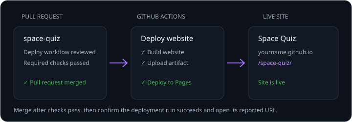

Space Quiz を GitHub Pages にデプロイして、誰でもアクセスできるようにします。Copilot はワークフローの準備やデプロイの案内を行えますが、変更をレビューし、サイトが公開されたことを確認する責任はユーザーにあります。

このレッスンでは、次の操作を行います。

- Copilot に GitHub Pages へのデプロイ構成を依頼します。
- マージする前に、ワークフローとプル リクエストをレビューします。
- デプロイの進行を確認し、公開されたサイトを検証します。

## シナリオ

Space Quiz はすでに GitHub リポジトリにありますが、誰でも簡単に試せる方法が必要です。単一ファイルのサイトを GitHub Pages で公開すれば、サーバーやランタイム依存関係を追加せずに、公開 URL からアクセスできるようになります。

## Copilot にデプロイの準備を依頼する

> [!WARNING]
> プル リクエストを作成すると、コードがコミットおよびプッシュされることがあります。このプロンプトを送る前に、承認設定と送信先のリポジトリを確認してください。**Approve all** を選択している場合、別の確認プロンプトは表示されないと考えてください。

`space-quiz` の Copilot app セッションで、次のプロンプトを送信します。

```plaintext
このリポジトリの GitHub Pages へのデプロイを準備してください。必要に応じてサイトをビルドし、変更が既定のブランチに反映された後に GitHub Pages へデプロイする GitHub Actions ワークフローを作成してください。README がまだない場合は、アプリとローカルでの実行方法を説明する README を追加してください。これらの変更でプル リクエストを作成し、そのリンクと必要な Pages の設定または権限を報告してください。マージ、自動マージの有効化、Pages の設定変更、デプロイは行わないでください。停止して、レビューを待ってください。
```

## ワークフローとプル リクエストをレビューする

1. リポジトリに README がまだない場合に限り、追加されていることを確認します。
2. ワークフローのビルドとデプロイの手順、トリガー、権限を含め、プル リクエストの変更をレビューします。
3. ワークフローが未マージのプル リクエストではなく、既定のブランチからデプロイすることを確認します。
4. 必要な修正を依頼し、更新された diff をレビューします。マージを許可する前に、必須のプル リクエスト チェックが成功するまで待ちます。

## マージとデプロイを許可する

> [!WARNING]
> 次のプロンプトは、レビュー済みのプル リクエストのマージ、リポジトリの Pages 設定の変更、サイトの公開をエージェントに許可します。レビューを完了し、リポジトリとプル リクエストを確認した後にのみ送信してください。承認設定によっては、別の確認プロンプトなしでこれらの操作が実行される場合があります。

`<PR_NUMBER>` をレビューしたプル リクエストの番号に置き換え、このプロンプトを別に送信します。

```plaintext
このリポジトリのプル リクエスト <PR_NUMBER> をレビューし、マージとデプロイを許可します。GitHub Actions を使って GitHub Pages を有効にし、必須チェックの成功後に限りそのプル リクエストをマージして、デプロイが成功するまで監視してください。公開されたウェブサイトの最終 URL を報告してください。Pages の有効化またはマージの権限がない場合は、私が何を承認または実行する必要があるかを正確に説明してください。サイトが実際に公開されるまで、成功したと報告しないでください。
```



## デプロイを確認する

1. GitHub Actions のデプロイ実行が成功するまで確認します。
2. 報告された URL を開き、Space Quiz が表示されることを確認します。

エージェントが Pages の有効化やプル リクエストのマージを行えない場合は、提示された具体的な手順に従います。デプロイが成功し、公開サイトが読み込まれるまで、作業を完了したと見なさないでください。

## まとめと次のステップ

Space Quiz をサイトとして公開し、エージェントの報告に頼らずデプロイを確認しました。次は[レッスン 13: レビューと次のステップ][next-lesson]に進みます。

[next-lesson]: ../13-review/
